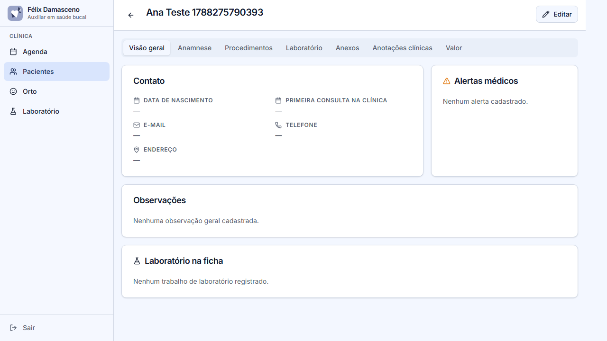
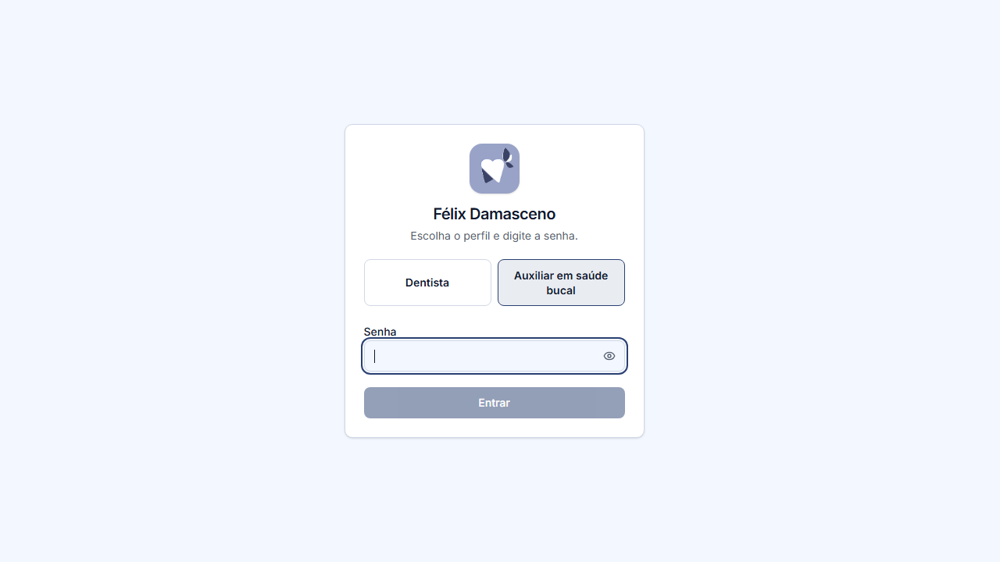

### Diogo Silva — Analista de Testes de Software (QA)

Em transição de carreira da área da saúde para a tecnologia, atuo como Analista de Testes de Software (QA) em projetos freelancer, aprendendo desenvolvimento na prática junto com o trabalho de testes.

### O que eu faço

- Planejamento e escrita de casos de teste (manuais e automatizados)
- Testes end-to-end com Playwright
- Testes unitários de regras de negócio
- Investigação e triagem de bugs (reprodução, isolamento de causa raiz)
- Validação de controle de acesso por perfil (RBAC) e isolamento de dados

### Projetos com testes

**Félix Damasceno — Sistema de Gestão de Clínica Odontológica**

Sistema completo para clínica odontológica: agenda, prontuário de pacientes, laboratório, relatórios e pagamentos, com dois perfis de acesso (auxiliar e dentista) e suporte a dentistas convidados.

Suíte de testes end-to-end (Playwright) cobrindo cenários reais de negócio:

- Login com senha inválida é bloqueado e exibe alerta
- Auxiliar não enxerga o menu administrativo (Relatórios, Pagamentos, Configurações)
- Dentista acessa toda a área administrativa
- Isolamento de dados entre dentista convidado e pacientes da clínica
- Redefinição de senha pelo próprio usuário convidado
- Fluxo de cadastro público com aprovação (pendente, aceito e recusado)
- Bloqueio de cadastro com e-mail duplicado

  
  
  

Gravação da suíte Playwright em execução (login → cadastro de paciente → relatórios):

Repositório privado — acesso disponível sob pedido.

**INDICA — Calculadora de Indicadores de Saúde Bucal (SUS)**

Ferramenta que calcula os seis indicadores odontológicos oficiais da Atenção Primária (PCO, TOC, escovação, B3, B5 e B6/TRA-ART) a partir dos relatórios do sistema único de saúde.

Testes automatizados (Node.js) cobrindo as regras de negócio: faixas oficiais de cada indicador, conferência SIAPS e cálculo da nota final da equipe.

Repositório público: github.com/Diogo-Silva096/Indica-

**Futebol Real — Jogo de carreira de futebol (em desenvolvimento)**

Jogo de carreira de futebol inspirado em New Star Soccer, construído em Godot 4 e GDScript.

Repositório privado.

### Stack e ferramentas

Playwright · JavaScript / TypeScript · Testes E2E · Testes unitários · Git e GitHub · SQL (SQLite / D1)

### Contato

LinkedIn: in/diogo-silva123
E-mail: diogovozao@hotmail.com
